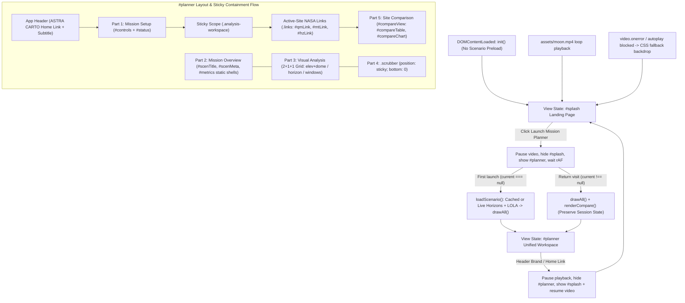

# ASTRA CARTO — Landing Page & Mission Planner UX Redesign

*   **Author:** waseem
*   **Status:** Draft
*   **Date:** 2026-11-15

--------------------------------------------------------------------------------

## Overview

**ASTRA CARTO** (*"Explore the Moon. Plan with Precision."*) is the visual and interaction redesign of the existing zero-dependency Lunar Landing Site Planner (`index.html`, `style.css`, `app.js`). The application computes solar illumination, direct-to-Earth visibility, 360° LRO LOLA DEM horizon obstruction, and overlapping full-operations windows across 20 curated lunar sites and custom coordinates using bundled 2025–2029 JPL Horizons data (`data/*.js`), bundled horizon masks (`data/horizons.js`), and optional live NASA/JPL fetches.

This design transforms the application into two coordinated single-page views sharing the same Refined Dark deep-navy palette and solar gold (`#f2c14e`) / Earth blue (`#5aa9e6`) accents:

1. **Independent Landing Page (`#splash`)**: A minimal, cinematic entry view over the looping `assets/moon.mp4` video with **ASTRA CARTO** branding, tagline, one-sentence overview, static video-error fallback, and a primary `Launch Mission Planner` CTA.
2. **Five-Part Mission Planner Workspace (`#planner`)**: An English-only workspace containing a subtle header return link to `#splash`, **Mission Setup**, **Mission Overview** (all 9 metrics), **Visual Analysis** (`2+1+1` desktop canvas grid), a compact bottom-docked **Sticky Mission Timeline Bar**, active-site external NASA links, and in-memory **Site Comparison**, enhanced with persistent accessible `ⓘ` scientific glossary tooltips while keeping 100% of existing math, data loaders, and offline `file://` compatibility intact.

## The Problem

Inspecting [index.html](file:///c:/Users/wasee/OneDrive/Desktop/Lunar%20Landing/index.html), [style.css](file:///c:/Users/wasee/OneDrive/Desktop/Lunar%20Landing/style.css), and [app.js](file:///c:/Users/wasee/OneDrive/Desktop/Lunar%20Landing/app.js) highlights six concrete defects in the current user experience:

1. **Auto-Destroying Splash Screen (`index.html:13-17`, `app.js:1368-1385`)**: `#splashVideo` lacks a `loop` attribute, and `initSplash()` binds `video.onended = finish`, `video.onerror = finish`, `splash.addEventListener("click", finish)`, and `setTimeout(finish, 15000)`, deleting `#splash` via `splash.remove()`. Visitors cannot read branding cleanly, cannot return to the landing view without a reload, and hit a blank `#000` background if timers are removed without a fallback visual.
2. **Hidden-Layout Canvas Crash (`app.js:697-705, 829-836, 1323-1363`)**: Calling `loadScenario()` eagerly on `DOMContentLoaded` while `#gate` is `hidden` (`display: none !important`) causes `setupCanvas()` to read `0×0` bounding boxes and return `W = 0, H = 0`. In `drawDome()`, radius `R = Math.min(0, 0) / 2 - 26 = -26` throws `IndexSizeError` in `ctx.arc(...)`, which `loadScenario()` catches and misreports behind the splash screen as a JPL Horizons CORS relay error.
3. **Confusing Onboarding Prompt & Awkward Timeline Flow (`index.html:22, 85-120`)**: `#gate` displays stale setup prompt copy even when a default scenario loads, while `.scrubber` sits mid-page between `#domeChart` and `#horizonChart`, forcing users to scroll away from upper metrics/charts or lower charts while scrubbing time.
4. **60 FPS DOM Destruction vs. Tooltip Stability (`app.js:630-693, 1131-1165`)**: During `▶ Play` or slider dragging, `drawAll()` calls `computeStats(sc, scrubT)` twice per frame and overwrites `$("metrics").innerHTML` up to 60 times/sec. Mounting interactive `ⓘ` triggers inside `#metrics` without structural separation would destroy active hover, open popovers, and keyboard focus every 16.6 ms.
5. **Tablet Column Squeeze & Hardcoded Slate Canvas Colors (`style.css:79-115`, `app.js:11-12, 749-1128`)**: `.charts` flex-basis rules squeeze or wrap `#domeChart` unpredictably while the `@media (max-width: 700px)` breakpoint leaves narrow `701–960px` columns clipped; meanwhile, Canvas 2D functions hardcode `#10151c` and `#2a3340` literals independent of CSS `:root` theme variables.
6. **Non-Specialist Accessibility & Input Edge Cases (`app.js:1215-1239, 1314`)**: Scientific terms (`Solar Power Proxy`, `LRO LOLA DEM`, `Azimuth`, horizon masks) lack `ⓘ` explanations; `#compareBtn` gives no confirmation/counter; and `startInput` slicing (`v + ":00Z".slice(v.length === 16 ? 3 : 0)`) silently falls back to `Date.now()` when seconds (`length === 19`) appear.

## Goals

*   **Permanent Landing View with Graceful Video Fallback**: Keep `#splash` active until the user clicks `Launch Mission Planner`; loop `assets/moon.mp4`; remove the 15s timeout, click-anywhere dismiss, and `video.onerror = finish` auto-skip; swap broken/blocked video cleanly to a static deep-navy lunar backdrop inside `#splash`.
*   **Reload-Free Landing Return & Deferred Boot Initialization**: Add a subtle **ASTRA CARTO** home control in the planner header to switch back to `#splash` without resetting in-memory session scenarios; defer `loadScenario()` (Shackleton Rim initialization) until `"Launch Mission Planner"` makes `#planner` visible with non-zero layout bounds.
*   **Unified Refined Dark Theme**: Apply a consistent deep-navy palette with subtle gold (`#f2c14e`) and Earth blue (`#5aa9e6`) accents across both HTML/CSS panels and Canvas 2D charts via shared `:root` design tokens.
*   **Full View `2+1+1` Visual Analysis Grid**: Keep all 4 scenario charts permanently expanded (top row: `#elevChart` ~65% + `#domeChart` ~35%; second row: `#horizonChart` 100%; third row: `#windowsChart` 100%) on desktop (`> 960px`), transitioning cleanly to a single column (`<= 960px`) with `ResizeObserver`-driven canvas sizing.
*   **Sticky / Docked Mission Timeline Bar**: Anchor `.scrubber` across Mission Overview and Visual Analysis using a compact bottom sticky bar (`~68–84px`) that rests above active NASA links and unsticks cleanly before `#compareView`.
*   **60 FPS Accessible Scientific Tooltips**: Add keyboard-, click-, and hover-accessible `ⓘ` glossary triggers whose focus and popover visibility survive `▶ Play` playback via static card shells and shared per-frame stats.
*   **100% Functional & `file://` Preservation**: Retain all 20 curated sites + custom coordinates, bundled JS data loaders (`window.__LSP_DATA`, `window.__LSP_HORIZONS`), live JPL Horizons / LOLA DEM fetches, 4 horizon modes, 9 metrics, 4 charts + comparison overlay, strictly in-memory `compares` (no `localStorage`), NASA deep links (`#qmLink`, `#mtLink`, `#hzLink`), and offline `file://` operation.

## Non-Goals

*   Introducing `localStorage`, `sessionStorage`, IndexedDB, or any browser storage persistence (`saveCompares()` and `restoreCompares()` remain no-ops).
*   Preloading Shackleton Rim ephemerides or running astronomical math while resting on `#splash`.
*   Adding Compact View, collapsible chart accordions, chart visibility toggles, or a view-mode switch.
*   Modifying planetary ephemeris datasets (`data/*`), Python generator tools (`tools/*`), ray-marching math, `projectLunar()`, or JPL Horizons query parameters.
*   Adding external font/icon CDNs, npm dependencies, build bundlers, ES `<script type="module">` tags, marketing sections, user accounts, or multi-language translation.

## Open Questions

None — all architectural and UX decisions were resolved during EGM Brainstorm (`concepts_brief.md`).

## Critical User Journeys (CUJs)

### CUJ 1: Permanent Landing Experience, Video Fallback, and Lazy Planner Launch

*   **Given**: The user opens `index.html` offline via `file://` or HTTP(S).
*   **When**: The page loads, or `assets/moon.mp4` fails to decode / autoplay is blocked; then the user clicks `"Launch Mission Planner"`.
*   **Then**:
    *   `#splash` stays visible indefinitely with looping `moon.mp4` (or falls back in-place via `data-video-state="fallback"` to a deep-navy styled lunar backdrop while keeping the CTA clickable).
    *   Zero scenario loads, JPL network calls, or `0×0` canvas draws occur before launch.
    *   Clicking `"Launch Mission Planner"` pauses `#splashVideo`, hides `#splash`, reveals `#planner`, waits one `requestAnimationFrame` for non-zero layout geometry, and runs `loadScenario()` once to populate Shackleton Rim (`shack`) with full-DPI crisp charts and valid `setupCanvas()` dimensions.
    *   Clicking the subtle header **ASTRA CARTO** home button returns cleanly to `#splash` (`video.play()` if healthy) and preserves `current` and `compares` when re-entering `"Launch Mission Planner"`.

### CUJ 2: Mission Setup, 2+1+1 Visual Analysis Scrolling, and Sticky Timeline Scrubbing

*   **Given**: The Mission Planner displays an active scenario at desktop (`> 960px`) or tablet/mobile (`<= 960px`) widths.
*   **When**: The user adjusts Mission Setup (`#siteSelect`, `#startInput`, `#durationSelect`, `#horizonSelect`), clicks `Load scenario`, and scrolls through Mission Overview and Visual Analysis while dragging `#scrub` or toggling `#playBtn` / `#nowBtn`.
*   **Then**:
    *   Desktop displays `#elevChart` (`~65%`) beside `#domeChart` (`~35%`) above full-width `#horizonChart` and `#windowsChart`; viewports `<= 960px` stack cleanly into `1+1+1+1` columns without horizontal overflow, and `ResizeObserver` re-renders sharp HiDPI canvases.
    *   `.scrubber` remains docked at the viewport bottom across Mission Overview and Visual Analysis (`<= 84px` compact height on desktop), never covering `#windowsChart` when scrolled to the bottom of Visual Analysis, and unsticks cleanly before `#compareView`.

### CUJ 3: Scientific Accessibility Tooltip Inspection During 60 FPS Playback

*   **Given**: The scenario timeline is actively animating at 60 FPS via `▶ Play`.
*   **When**: A user hovers over, clicks, or keyboards (`Tab` + `Enter`/`Space`) onto any `ⓘ` icon in Mission Setup, Mission Overview cards, chart headings, or timeline readouts.
*   **Then**:
    *   A plain-English explanation renders inside `#tooltipPopover` anchored cleanly inside viewport bounds without clipping by `.tablewrap` or grid edges.
    *   Updating `.v`, `.d`, and countdown values each animation frame mutates only text slots (`textContent`), leaving the `ⓘ` button mounted, focus intact, and the popover open until blurred, toggled, `Escape`-dismissed, or closed via outside click.

### CUJ 4: Active-Site NASA Links & In-Memory Site Comparison

*   **Given**: A scenario is active (`compares.length === 0` or `1..6`).
*   **When**: The user inspects external NASA links below Visual Analysis, clicks `Add to comparison` (`#compareBtn`), switches horizon models (`#horizonSelect`), or clicks `✕` / `#clearCompare`.
*   **Then**:
    *   `#qmLink`, `#mtLink`, and `#hzLink` remain visible and populated in `.links` directly below Visual Analysis (outside `#compareView`) even with zero comparisons queued.
    *   Adding a scenario updates `#compareBtn` (`N/6`) and status confirmation, appending rows to `#compareTable` (with active horizon model context) and overlaying curves in `#compareChart` strictly in-memory for the session.

## Technical Plan (Architecture)

### 1. View State Machine & Lazy Boot Lifecycle
*   **HTML View Containers**: Wrap the Mission Planner shell (`<header class="app-header">`, Mission Setup `#gate`/`#controls`, `#status`, and `<main>`) inside `
`. Both `#splash` and `#planner` carry `[hidden]` toggling cleanly under `style.css:44` (`[hidden] { display: none !important; }`). Preserve `#gate` and `#splashSkip` IDs so external/script references remain valid.
*   **Landing Video & Static Fallback**: Add `loop` on `#splashVideo`. Remove `setTimeout(finish, 15000)`, `splash.addEventListener("click", finish)`, `video.onended = finish`, and `video.onerror = finish`. Instead:
    *   If `video.error` fires or `video.play()` rejects, set `splash.dataset.videoState = "fallback"` to hide `<video>` visually and activate a pure-CSS radial deep-navy + subtle cratered horizon/starfield background inside `#splash`.
    *   Respect `@media (prefers-reduced-motion: reduce)` by pausing background motion cleanly.
*   **`enterPlanner()` / `returnToLanding()`**:
    *   `enterPlanner()`: pauses `#splashVideo`, pauses nothing if already paused, sets `splash.hidden = true` and `planner.hidden = false`, schedules `requestAnimationFrame(() => { if (!current) { loadScenario(); } else { drawAll(); if (compares.length) renderCompare(); } $("plannerHeading")?.focus(); })`.
    *   `returnToLanding()`: stops timeline animation if running (`if (playing) togglePlay()`), hides `#tooltipPopover`, sets `planner.hidden = true` and `splash.hidden = false`, and resumes `#splashVideo.play().catch(() => {})` if not in fallback/reduced-motion state.

### 2. Refined Dark Design System & Canvas Theme Synchronization
Define centralized `:root` tokens in `style.css` so UI panels, typography, and Canvas 2D surfaces share one deep-navy visual language:

| Token | Proposed Value | Usage |
| :--- | :--- | :--- |
| `--bg` | `#070b14` | Primary deep-navy document background |
| `--bg-elevated` | `#0b1220` | Canvas interior backdrop & landing fallback gradient base |
| `--panel` | `#10192b` | Cards, chart containers, Mission Setup & Comparison panels |
| `--panel2` | `#162238` | Inputs, buttons, secondary headers, table `<th>` surfaces |
| `--line` | `#233352` | Hairline container borders & Canvas 2D major grid lines |
| `--line-soft` | `#19253d` | Subtle Canvas 2D polar rings (`30°`/`60°`) & sub-grid strokes |
| `--text` | `#e6edf7` | Primary headings, metric values, high-contrast labels |
| `--muted` | `#8da2c0` | Secondary captions, axis tick labels, units |
| `--sun` | `#f2c14e` | Solar curves, metric accents, gold focus highlight |
| `--earth` | `#5aa9e6` | Earth curves, metric accents, blue interactive highlight |
| `--horizon` | `#e07a4f` | LOLA terrain ridge mask, shade hatching & warning state |
| `--ok` | `#7ec850` | Simultaneous Sun+Earth operational window highlight |
| `--accent` | `#5aa9e6` | Unified blue interactive focus/accent (slider & primary ring) |

In `app.js`, replace hardcoded slate literals inside Canvas 2D drawing (`#10151c`, `#2a3340`, `#232d3a`, `#3a4657`, `#2f3a4a`, `#212934`, `#55637a`, `#8b98a8`, `#dce3ec`, `#4ecdc4`) with a lightweight `getThemeTokens()` reader pulling `:root` CSS variables via `getComputedStyle(document.documentElement)`.

### 3. Five-Part Workspace Layout, `2+1+1` Grid & Sticky Timeline Geometry
*   **Part 1 — Mission Setup (`header.app-header` + `#gate` / `#controls`)**:
    *   Compact top bar with **ASTRA CARTO** brand mark + `"Mission Planner"` label (clickable `<button id="homeBtn">` returning to `#splash`), subtle horizon badge, and cached data window helper note (`Cached ephemeris: 2025–2029 UTC`).
    *   Clean CSS Grid/Flex layout for `#controls` without `<label>&nbsp;</label>` spacers; `#horizonSelect` includes a subtle `ⓘ` trigger and badge indicating instant recalculation; `#compareBtn` displays `Add to comparison (N/6)` and updates `#status` with feedback when appended.
*   **Part 2 & Part 3 Sticky Wrapper (`.analysis-workspace`)**:
    *   Encloses `#scenTitle`/`#scenMeta`, Part 2 (`#metrics`), Part 3 (`.charts-grid`), and Part 4 (`.scrubber`) as its **final child**.
    *   `html, body` and `.analysis-workspace` must avoid `overflow: hidden` (use `overflow-x: clip` where overflow containment is needed) so CSS `position: sticky; bottom: 0` functions reliably.
    *   **Visual Analysis `2+1+1` Grid (`.charts-grid`)**:
        *   `> 960px` desktop: CSS Grid with `grid-template-columns: minmax(0, 1.85fr) minmax(0, 1fr)` (~65% / ~35%); `.chartbox` sets `min-width: 0`. Row 1 places `#elevChart` (`elevBox`) on left and `#domeChart` (`domeBox`, `aspect-ratio` / `height: 360px` aligned with `elevChart` height `360px`) on right; Rows 2 (`#horizonChart`, `230px`) and 3 (`#windowsChart`, `200px`) set `grid-column: 1 / -1`.
        *   `<= 960px` tablet/mobile: `grid-template-columns: minmax(0, 1fr)` (single-column vertical stack), adjusting `#domeChart` corner `belowNotes` rendering if canvas width drops below `380px` so text never clips.
    *   **Part 4 — Compact Sticky Mission Timeline Bar (`.scrubber`)**:
        *   Docked cleanly with `position: sticky; bottom: 0; z-index: 20`, backdrop blur + solid navy background (`rgba(16, 25, 43, 0.96)`), subtle top accent hairline/shadow, and compact two-band strip (`~72–82px` desktop): Band A pairs `#playBtn`, `#nowBtn`, `#scrubTime`, and `#scrub` slider horizontally; Band B renders compact single-row inline readout chips (`#scrubSun`, `#scrubEarth`, `#scrubNextSet`, `#scrubNextESet`).
        *   Unsticks naturally below `max-height: 620px` and `max-width: 720px` media queries (`position: static`) so small laptop/phone screens never lose 25%+ height to sticky chrome; adds `scroll-padding-bottom: 96px` on `:root` so keyboard tabbing never hides focused controls behind the sticky bar.
*   **Part 5 — Active NASA Links & In-Memory Site Comparison**:
    *   Place `.links` (`#qmLink`, `#mtLink`, `#hzLink`, displaying active site name: `"Open <site> in:"`) right after `.analysis-workspace` so it sits visually below the resting `.scrubber` and stays visible whenever a scenario is active (`compares.length === 0` included).
    *   Keep `#compareView` (`#compareTable` showing active `horizonLabel` column/subtitle + `#compareChart` + `#clearCompare`) strictly in-memory (`saveCompares()` and `restoreCompares()` remain no-ops).

### 4. Persistent Metric Card DOM & Scientific Tooltip Architecture
*   **Single `computeStats()` Pass & Persistent Card Shells (`app.js:502-557, 630-693, 1131-1173`)**:
    *   Split `initMetricCards()` (run once during `init()` or when `#metrics` is empty) from `renderMetrics(sc, st)`: `initMetricCards()` builds the 9 `.card` containers with persistent ``, `<button type="button" class="info-btn" data-tip="...">ⓘ</button>`, `
`, and `
` nodes.
    *   Factor `drawAll()` to compute `const st = computeStats(sc, scrubT)` (or precomputed static window stats cached on `sc._cachedStats` keyed by `horizonMode()`) **once per frame**, passing `st` into both `renderMetrics(sc, st)` and `renderScrubReadout(sc, st)`.
    *   `renderMetrics(sc, st)` mutates only `textContent`, `hidden` flags, and `.sun`/`.earth` classes on those cached DOM element references—zero `innerHTML` replacement at 60 FPS.
*   **Accessible Glossary & Popover Controller**:
    *   Attach `
` at document root (`<body>`), styled independently from global `button`/`overflow-x: auto` rules.
    *   Hover (`mouseenter`/`mouseleave` with slight exit grace), `focusin`/`focusout`, or click (`click` toggle + `aria-expanded`) positions `#tooltipPopover` using `getBoundingClientRect()` clamped inside `[12px, window.innerWidth - 12px]` horizontally and flipped above/below dynamically; `Escape` or outside click closes active popovers cleanly.

| Term / Placement | Plain-English Tooltip Content |
| :--- | :--- |
| `Solar elevation` (Overview & Charts) | Angle of the Sun above (`+`) or below (`-`) the mathematical 0° lunar horizon plane at the selected time. Positive angles above local terrain deliver sunlight. |
| `Azimuth` (Overview & Timeline) | Compass direction around the horizon measured clockwise from lunar North (`0° = N`, `90° = E`, `180° = S`, `270° = W`). |
| `Next sunset / sunrise` (Overview & Timeline) | Time remaining until the Sun next crosses below or above the active terrain horizon mask inside the selected mission window. |
| `Peak Sun elevation` (Overview) | Highest solar angle reached during the chosen window. Higher angles reduce shadow length and increase horizontal solar panel output. |
| `Sunlit %` (Overview) | Percentage of hourly window samples where the Sun clears both the mathematical horizon and any selected terrain mask ridge. |
| `Earth elevation` & `Earth visibility` (Overview & Timeline) | Earth's angle and percentage of time clear of local terrain. Unlike equatorial/mid-latitude sites where Earth stays fixed high in the sky, polar sites see Earth nod slowly near the horizon due to lunar libration, making terrain ridges critical for direct-to-Earth radio. |
| `Solar power proxy (level panel)` (Overview) | Geometric `sin(elevation)` factor for a flat horizontal solar array (`100%` if Sun were at zenith, `0%` when shaded by terrain or below horizon), before panel efficiency or thermal limits. |
| `Sunlit AND Earth-visible` (Overview) | Full-operations overlap when the lander simultaneously receives direct sunlight for power and line-of-sight to Earth for communications. |
| `Local terrain horizon` & `Horizon model` (Setup & Overview) | Angular height of surrounding lunar topography (360° profile derived from NASA LRO LOLA laser altimetry). **LRO LOLA DEM** uses real ridges; **+1.5° floor** adds a conservative surface clearance margin; **Flat 1.5°** and **0° sphere** ignore ridges for comparison. |
| `Sky dome` & `Operational windows` (Chart headings) | **Sky dome** projects the hemisphere overhead (zenith at center, North at top, East on left looking upward, orange terrain mask along perimeter). **Operational windows** maps hourly periods of daylight, Earth visibility, and combined operations across the window. |

## Alternatives Considered

### Alternative A: Compact View with Collapsible Chart Sections + View-Mode Toggle
*   **Pros**: Reduces initial page height by collapsing secondary charts behind headers.
*   **Cons**: Hides important cross-chart correlations (such as matching a dip in `Elevation vs time` with a ridge peak in `Local terrain horizon`), adds UI chrome, and risks `setupCanvas()` measuring `0×0` inside collapsed `
`/`display: none` wrappers.
*   **Reason for Rejection**: Rejected by author: users must see all four scientific plots simultaneously without extra clicks or mode switching.

### Alternative B: Static In-Flow Mission Timeline Below Charts
*   **Pros**: Zero CSS sticky stacking rules and zero bottom viewport footprint while scrolling.
*   **Cons**: Forces constant vertical scrolling between the scrubber at the bottom and **Mission Overview** cards or top `#elevChart`/`#domeChart` charts whenever scrubbing time.
*   **Reason for Rejection**: Rejected by author: time scrubbing and playback control the entire analysis experience and belong within reach across Mission Overview and Visual Analysis.

### Alternative C: Strict `1+1+1+1` Single-Column Desktop Chart Stack
*   **Pros**: Uniform full-width card layout on every breakpoint.
*   **Cons**: Stretching the circular polar `#domeChart` (`340–360px` tall) across a ~1,180 px desktop container leaves ~70% horizontal empty space and lengthens vertical scrolling unnecessarily.
*   **Reason for Rejection**: Rejected by author: pairing `#elevChart` (~65%) beside `#domeChart` (~35%) fits the polar geometry naturally on desktop while falling back cleanly to single-column on tablet/mobile.

### Alternative D: Auto-Dismissing Splash Screen (`15s` Timer / Click-Anywhere / `video.onerror` Skip)
*   **Pros**: Moves visitors automatically into `#gate` after video completion or timeout.
*   **Cons**: Prevents **ASTRA CARTO** branding and description from acting as an intentional landing experience and drops users abruptly out of the video even mid-read.
*   **Reason for Rejection**: Rejected by author: the landing page must remain active until `"Launch Mission Planner"` is explicitly clicked and must gracefully hold a static visual if video fails.

### Alternative E: Adding `localStorage` Persistence for Scenario Comparisons
*   **Pros**: Could remember queued comparison rows across browser refreshes in unconstrained HTTP origins.
*   **Cons**: Current code disables storage cleanly (`saveCompares()`/`restoreCompares()` are intentional no-ops at `app.js:1225-1227`) because sandboxed `null`-origin previews throw `SecurityError`, `file://` storage isolation varies per browser, storing raw series blows past ~5 MB quotas, and lazy `ensureSeries()` fails offline for custom coordinates.
*   **Reason for Rejection**: Rejected by author: scenario comparisons remain strictly in-memory for the active session as currently implemented.

### Alternative F: Placing Active-Site NASA Links (`#qmLink`, `#mtLink`, `#hzLink`) Inside `#compareView`
*   **Pros**: Consolidates bottom links into Part 5 visually when comparisons exist.
*   **Cons**: `#compareView` is `hidden` whenever `compares.length === 0` (`app.js:1243`), hiding QuickMap, Moon Trek, and JPL Horizons links for single-site analysis when those links belong to `current`.
*   **Reason for Rejection**: Rejected by author: active-site NASA links stay visible below Visual Analysis (above `#compareView`) whenever a mission scenario is loaded.

### Alternative G: Eager Background Scenario Loading on Landing Page
*   **Pros**: First chart paint appears immediately when entering `#planner` (if data already loaded).
*   **Cons**: Wastes compute on `#splash`, triggers premature JPL CORS relays if system time exceeds `CACHE_END` (`2029-01-01`), and exposes `setupCanvas()` / `drawDome()` to `0×0` `IndexSizeError` crashes on hidden canvases.
*   **Reason for Rejection**: Rejected by author: initialize Shackleton Rim cleanly only after `"Launch Mission Planner"` reveals visible planner geometry.

--------------------------------------------------------------------------------

## Non-Functional Requirements

*   **Offline `file://` Portability & Zero Runtime Dependencies**: Use plain `<script defer>` / classic `<script>` tags, zero external fonts/icons/CSS CDNs, zero `?v=` query strings on asset URLs, system typography stacks, Unicode/inline-SVG graphics, and preserve `<script data-pplx-inline-edit>` intact in `index.html`.
*   **60 FPS Scrubbing & Playback Performance**: Keep animation `step()` and slider `scrubFromSlider()` frame times under `16.6 ms` by sharing a single `computeStats()` result (or cached scenario-invariant stats + O(k) crossing lookup) per `drawAll()` call and updating metric cards strictly via `textContent`.
*   **Canvas Safety & Responsive Geometry**: Guard `setupCanvas()` when `r.width < 10 || r.height < 10` (returning null/skip indicator so `drawDome()` never computes negative radius `R`) and wire a `ResizeObserver` on `.charts-grid` / `#compareChart` wrappers so breakpoint transitions always redraw crisp HiDPI backing stores.
*   **Async Reliability & Date Validation**: Guard `loadScenario()` against out-of-order async clicks with a monotonic `loadSeq` token; pause `playing` playback on new scenario loads; fix `startInput` UTC parsing to accept both `YYYY-MM-DDTHH:MM` and `YYYY-MM-DDTHH:MM:SS`; surface a clear notice when LOLA DEM falls back to `flat-fallback` or when live Horizons fetches are invoked outside `2025–2029 UTC`.

--------------------------------------------------------------------------------

### Additional Resources

*   Concept brief & Goldfish findings synthesis: [concepts_brief.md](file:///c:/Users/wasee/OneDrive/Desktop/Lunar%20Landing/concepts_brief.md)
*   Existing architecture & data contracts: [README.md](file:///c:/Users/wasee/OneDrive/Desktop/Lunar%20Landing/README.md), [data/README.md](file:///c:/Users/wasee/OneDrive/Desktop/Lunar%20Landing/data/README.md), [tools/README.md](file:///c:/Users/wasee/OneDrive/Desktop/Lunar%20Landing/tools/README.md)

--------------------------------------------------------------------------------

## Detailed Implementation Plan

### Target Files to Modify

#### 1. `./index.html` (Modify)
*   **Type / Scope**: Application HTML structure & metadata (lines `1-143`; leave inline-edit script lines `144-584` untouched).
*   **Proposed Changes**:
    *   Update `<title>` to `ASTRA CARTO — Explore the Moon. Plan with Precision.` and update inline SVG favicon palette to deep navy (`#070b14`), gold (`#f2c14e`), and blue (`#5aa9e6`).
    *   Update `#splash`: add `loop` to `<video id="splashVideo" autoplay muted loop playsinline preload="auto" src="assets/moon.mp4">`, add scrim + fallback visual layer (`.splashScrim`), render **ASTRA CARTO** `<h1 class="splashTitle">`, `
Explore the Moon. Plan with Precision.
`, one concise product description `
`, and primary CTA button `<button id="splashSkip" class="splashCta">Launch Mission Planner</button>`.
    *   Wrap planner UI inside `
`:
        *   Add `<header class="app-header">` containing `<button type="button" id="homeBtn" class="brand-home">` (**ASTRA CARTO** mark + tagline return link) and header context text.
        *   Keep `#gate` (removing stale `"Select a landing site..."` gate text, keeping `#controls`, `#siteSelect`, `#customCoords`, `#latInput`, `#lonInput`, `#startInput`, `#durationSelect`, `#horizonSelect` with `ⓘ` trigger, `#loadBtn`, `#compareBtn`, `#status`, and cached-bounds hint `Cached ephemeris: 2025–2029 UTC`).
        *   Inside `<main>` / `<section id="scenarioView" hidden>`:
            *   Wrap **Part 2 (Mission Overview)** (`#scenTitle`, `#scenMeta`, `#metrics`), **Part 3 (Visual Analysis `.charts-grid`)** (Top row `.chartbox` wrapping `#elevChart` and `#domeChart` with section headings + `ⓘ` buttons; full-width `.chartbox` rows wrapping `#horizonChart` and `#windowsChart` with headings + `ⓘ` buttons), and **Part 4 (`.scrubber` compact sticky control bar keeping all IDs `#scrubTime`, `#playBtn`, `#nowBtn`, `#scrub`, `#scrubSun`, `#scrubEarth`, `#scrubNextSet`, `#scrubNextESet` plus compact `ⓘ` buttons on Sun/Earth/Azimuth)** inside `.analysis-workspace`.
            *   Place `.links` (`#qmLink`, `#mtLink`, `#hzLink`, displaying active site name) cleanly after `.analysis-workspace` and immediately before `#compareView`.
            *   Inside **Part 5 (`#compareView`)**: preserve `#compareTable`, `#compareChart`, `#clearCompare`, add active horizon-model note, and add an empty-state/header subtitle for the 6-scenario limit.
    *   Add shared root `

` right before `<script src="data/horizons.js">`.

#### 2. `./style.css` (Modify)
*   **Type / Scope**: Design tokens, Landing page styling, Refined Dark Mission Planner layout, `2+1+1` Grid, Sticky Timeline, Responsive breakpoints, and Tooltip Popover styles.
*   **Proposed Changes**:
    *   Replace `:root` palette with Refined Dark deep-navy tokens (`--bg: #070b14`, `--bg-elevated: #0b1220`, `--panel: #10192b`, `--panel2: #162238`, `--line: #233352`, `--line-soft: #19253d`, `--text: #e6edf7`, `--muted: #8da2c0`, `--sun: #f2c14e`, `--earth: #5aa9e6`, `--horizon: #e07a4f`, `--ok: #7ec850`, `--accent: #5aa9e6`). Enforce `overflow-x: clip` (never `overflow: hidden`) on page/workspace containers so sticky positioning functions cleanly.
    *   Style `#splash`: dark navy fallback gradient + subtle lunar orbit glow when `[data-video-state="fallback"]` or `@media (prefers-reduced-motion: reduce)` hides `#splashVideo`, centered editorial typography stack over `.splashScrim`, prominent gold/blue accent `"Launch Mission Planner"` CTA button, `cursor: default` on outer container.
    *   Style `.app-header` and `.brand-home`: crisp top navigation strip with hover/focus ring on the **ASTRA CARTO** home button.
    *   Style Mission Setup (`#controls`), Mission Overview (`.cards` / `.card` grid, tabular figures, semantic gold/blue left-or-top subtle accent indicators, clean alignment without `<label>&nbsp;</label>` spacers).
    *   Style Visual Analysis `.charts-grid`: `display: grid; grid-template-columns: minmax(0, 1.85fr) minmax(0, 1fr); gap: 14px;` with `.chartbox { min-width: 0; }` (`#elevChart` / `#domeChart` height `360px`, `.chartbox.full { grid-column: 1 / -1; }`, `#horizonChart` `230px`, `#windowsChart` `200px`), transitioning cleanly to `grid-template-columns: minmax(0, 1fr)` under `@media (max-width: 960px)`.
    *   Style Sticky Mission Timeline Bar (`.scrubber`): `position: sticky; bottom: 0; z-index: 20;` with translucent deep-navy backdrop + hairline top glow, compact two-row layout (`<= 84px` desktop), `scroll-padding-bottom: 96px` on `html`, and responsive un-sticking (`position: static`) below `max-height: 620px` and `max-width: 720px`.
    *   Style `.info-btn` (scoped override so inline `ⓘ` circle buttons stay small and crisp, distinct from `.panel button`) and `#tooltipPopover` (fixed viewport-clamped card with `max-width: 280px`, arrowless crisp border, subtle elevation).

#### 3. `./app.js` (Modify)
*   **Type / Scope**: View routing, deferred Shackleton Rim launch initialization, Canvas theme sync & dimension guards, shared `computeStats()`, persistent metric card DOM shells, popover tooltip controller, async cancellation, and input date fix.
*   **Proposed Changes**:
    *   **View & Media Controller (`initSplash()`, `enterPlanner()`, `returnToLanding()`)**:
        *   Remove `setTimeout(finish, 15000)`, `splash.addEventListener("click", finish)`, `video.onended = finish`, `video.onerror = finish`, and `splash.remove()`.
        *   On `video.error` or rejected `video.play()`, set `splash.dataset.videoState = "fallback"`.
        *   `init()` calls `populateSelect()`, `initSplash()`, `initTooltips()`, `initResizeObserver()`, and `initMetricCards()` — **not** `loadScenario()`.
        *   Clicking `#splashSkip` invokes `enterPlanner()` (`video.pause()`, swap `[hidden]`, `requestAnimationFrame` -> `loadScenario()` if `!current`, else `drawAll()` + `if (compares.length) renderCompare()`). Clicking `#homeBtn` invokes `returnToLanding()`.
    *   **Theme Token Helper (`getThemeTokens()`) & Canvas Guards**:
        *   Read `--bg-elevated`, `--line`, `--line-soft`, `--muted`, `--text`, `--sun`, `--earth`, `--horizon`, `--accent`, `--ok` from `getComputedStyle(document.documentElement)` (cached, refreshed on draw) and apply across `drawElevChart()`, `drawDome()`, `drawHorizonChart()`, `drawWindows()`, and `renderCompare()`.
        *   In `setupCanvas(c)`: if `r.width < 10 || r.height < 10`, return `null`; update callers (`drawElevChart`, `drawDome`, `drawHorizonChart`, `drawWindows`, `renderCompare`) to return early safely when `setupCanvas()` returns `null`. Also guard `drawDome()` radius `R = Math.max(10, Math.min(W, H) / 2 - 26)` and clip `belowNotes` neatly on narrow canvases.
        *   Attach `ResizeObserver` across `.charts-grid` and `#compareChart` wrapper to trigger debounced redraws alongside `window.resize`.
    *   **Shared `computeStats()` & Persistent Card Shells (`initMetricCards()`, `renderMetrics(st)`)**:
        *   Precompute scenario-invariant stats (window percentages, `longestDaylightMs`, `sunMaxEl/T`, `earthMinEl/MaxEl`, `horMin/Max/Mean`, `sunX`, `earthX`) cached per `(sc, horizonMode())`; on scrub frames, `drawAll()` resolves `st` once and passes it to both `renderMetrics(st)` and `renderScrubReadout(st)`.
        *   `initMetricCards()` creates all 9 `.card` DOM containers with static labels + `.info-btn` (`data-tip` keys) once; `renderMetrics(st)` updates only `.k-text`, `.v`, `.d`, and card visibility/accent classes via `textContent` without rebuilding `$("metrics").innerHTML`.
    *   **Tooltip Popover Controller (`initTooltips()`, `openTooltip(btn)`, `closeTooltip()`)**:
        *   Maintain static `TOOLTIPS` dictionary in English covering all scientific terms; support mouse hover, click toggle, keyboard focus, `Escape`, outside click, and scroll/resize repositioning clamped inside the viewport.
    *   **Reliability Fixes**:
        *   Add monotonic `loadSeq` token in `loadScenario()` so stale slow responses cannot overwrite newer clicks; reset `playing` before switching scenarios; separate fetch `try/catch` from render `try/catch`; fix `startInput` UTC parsing cleanly (`YYYY-MM-DDTHH:MM` or `YYYY-MM-DDTHH:MM:SS`); update `#compareBtn` label/count (`Add to comparison (N/6)`), `#qmLink`/`#mtLink`/`#hzLink` active-site context label, `#compareView` horizon model notice, and explicit `flat-fallback` DEM degraded warning in `#scenMeta` / `#status`.
        *   Preserve `saveCompares()` and `restoreCompares()` strictly as no-op in-memory stubs (`app.js:1225-1227`), all 20 `SITES[]`, `window.__LSP_DATA`, `window.__LSP_HORIZONS`, and all astronomical math unchanged.

#### 4. `./README.md` *(Post-Implementation Sync Only if Needed)*
*   **Type / Scope**: Update only UI/view-entry notes after code implementation is verified, leaving `data/*`, `data/README.md`, `tools/*`, and `tools/README.md` untouched.

### Verification Plan

*   **Offline `file://` & Zero-Dependency Integrity**: Confirm zero external `<link>`/`<script src="https://...">` tags, zero `localStorage` calls, untouched `data/` (`42` files) and `tools/` (`4` files), valid classic `<script>` loading, and intact `<script data-pplx-inline-edit>` inside `index.html`.
*   **Browser Verification — Landing Page (`file://` and local HTTP server)**:
    *   Confirm `#splash` renders with **ASTRA CARTO**, tagline *"Explore the Moon. Plan with Precision."*, short description, looping `assets/moon.mp4`, and `"Launch Mission Planner"` CTA.
    *   Wait >16s and click background areas on `#splash`: confirm `#splash` never auto-dismisses.
    *   Simulate missing/corrupt video (`moon.mp4` fallback check): confirm static deep-navy lunar backdrop renders and CTA stays interactive.
    *   Confirm zero `loadScenario()` network/script loads happen while resting on `#splash`.
*   **Browser Verification — Launch, `2+1+1` Grid, Sticky Timeline, Tooltips & Comparison**:
    *   Click `"Launch Mission Planner"`: confirm crisp initial Shackleton Rim charts with zero `IndexSizeError` or `50×50` canvas artifacts and clean Console.
    *   Inspect desktop (`1440×900`), tablet (`820×900`), and mobile (`390×844`) viewports: verify `2+1+1` (`~65% / ~35%` top row + full-width `#horizonChart` and `#windowsChart`) on desktop and single-column collapse `<= 960px` with no horizontal scrollbar or clipped `#domeChart` text.
    *   Scroll from top to `#compareView` and toggle `#playBtn` + drag `#scrub`: verify `.scrubber` stays docked across Overview + Visual Analysis, rests cleanly above `.links`, unsticks before `#compareView`, and keeps opened `ⓘ` tooltips + keyboard focus stable at 60 FPS.
    *   Click `#homeBtn` to return to `#splash`, then re-launch `"Launch Mission Planner"`: verify queued `compares` and active scenario persist cleanly in memory.
    *   Verify all 4 horizon modes (`lola`, `lola15`, `flat15`, `flat`), custom coordinate validation, and 6-scenario comparison overlay/removal.

--------------------------------------------------------------------------------

*Drafted with EGM*
